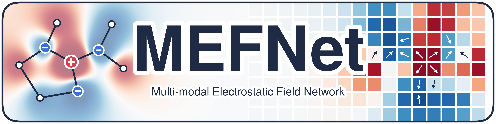
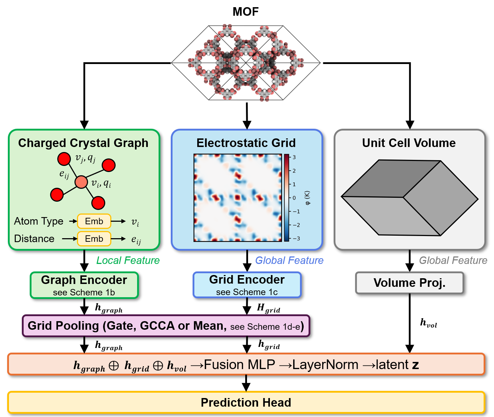

<p align="center">
  
</p>

# MEFNet

MEFNet predicts MOF properties from three inputs computed for each structure:
a charge-embedded crystal graph, a 3D Ewald electrostatic grid (potential and field components) and the unit cell volume.
It was developed for hydrophobicity classification and also supports regression.

The graph encoder is a CGCNN-style network with per-atom partial-charge embeddings. The grid is encoded by a patch-based 3D
network. Three ways of pooling the grid tokens are available (`--fusion_type`): `none` (mean pooling, the default and the final
model of the paper), `gate` (graph-gated) and `gcsa` (graph-conditioned cross-attention, GCCA).

## Architecture

<p align="center">
  
</p>

Each MOF enters as three inputs. The charged crystal graph (atoms, bonds and per-atom partial charges) is the local feature;
the four-channel electrostatic grid (potential and field) and the unit cell volume are global features. The graph encoder gives
`h_graph`, the grid encoder gives one token per patch of the unit cell (`H_grid`), and the tokens are pooled into `h_grid`, either
by mean pooling or conditioned on the graph (gate or GCCA). `h_graph`, `h_grid` and the projected volume `h_vol` are concatenated,
passed through a fusion MLP and layer normalisation, and mapped to the output by the prediction head. Sub-panels referred to as
Scheme 1b-e are in the paper.

## Install

```bash
conda create -n mefnet python=3.11
conda activate mefnet
git clone https://github.com/Chung-Research-Group/MEFNet.git && cd MEFNet
pip install -r requirements.txt
```

Install PyTorch separately by following https://pytorch.org/get-started/locally/ for your CUDA version. The weights and the
examples were run with PyTorch 2.6.0 and Python 3.11. A GPU is optional.

## Input data

| File | Required columns / content | Used by |
|---|---|---|
| CIF files, one per structure (`<id>.cif`) | Atom sites with partial charges in `_atom_site_charge`, one per site | `generate_graphs.py`, `generate_grids.py` |
| Label CSV | `id` plus `label` (classification, integer 0/1), or `id` plus one or more numeric target columns (regression; every non-id column is a target) | `split_*.py`, `train.py`, `tune.py`, `predict.py` |
| Structure CSV (optional) | `id` plus the grouping columns below | `split_group.py` |

The id column of the label CSV may be named `id`, `mof_id`, `name` or `coreid`. Ids must equal the CIF file names without `.cif`.

**Partial charges.** MEFNet needs a charge for every atom. A CIF without `_atom_site_charge` makes `generate_graphs.py` and
`generate_grids.py` stop with an error. Assign charges first, for example with PACMAN
(https://github.com/mtap-research/PACMAN-charge), which writes `_atom_site_charge`.

**Groups (optional).** Structures that are near-duplicates (same metal, linkers and topology) should not be split across train and
test. `split_group.py` accepts one of:

| Option | Meaning | If absent |
|---|---|---|
| `--group_col` | Column of the structure CSV with an existing group id | - |
| `--mofid_v1_col` / `--mofid_v2_col` + `--metal_col` | MOFid-v1 / v2 strings and the metal types; groups are built from metal, linker and topology (the metal column is required with them; `--refcode_col` is an optional cross-check) | - |
| none of the above | Every structure is its own group, which is equivalent to a random split | default |

**Folder structure** used by the commands below (all paths can be changed with options):

```
data/graphs/        <id>.npz            from generate_graphs.py
data/grids/         <id>.npy            from generate_grids.py
data/split/         split.json, split_assignment.csv
labels.csv          your label file
```

`data/coremof2024/` holds the dataset and splits used in the paper: the binary hydrophobicity labels, the group split
(`split.json`, `split_assignment.csv`) and the random split (`split_random.json`, `split_assignment_nogroup.csv`).
CIFs are available from the CoRE MOF 2024 database (https://zenodo.org/records/15055758).

`examples/` contains 20 CoRE MOF 2024 structures with classification and regression labels (see `examples/README.md`).

## Graphs and grids

```bash
python generate_graphs.py --cif_dir examples/cifs --output_dir data/graphs
python generate_grids.py  --cif_dir examples/cifs --output_dir data/grids --workers 4
```

Graph settings: cutoff radius 8 Å, 12 neighbours, Gaussian distance expansion with 0.2 Å step (`--radius`, `--max_num_nbr`).
Grid settings: 30 x 30 x 30 points, Ewald splitting parameter 0.25 Å⁻¹, four channels (potential and three field components),
z-score normalised (`--grid_size`, `--alpha`, `--recip_hmax`, `--no_normalize`). `--resume` skips existing grids. A grid takes
seconds to minutes per structure depending on the cell size, so use `--workers` for large sets.

## Split

Group split (default 8:1:1; `--n_folds` sets the number of folds, one validation fold, one test fold, the rest train):

```bash
python split_group.py --labels examples/labels_classification.csv --structures examples/structures.csv \
    --mofid_v1_col mofid-v1 --mofid_v2_col mofid-v2 --metal_col metal_types \
    --n_folds 5 --outdir data/split
```

Classification splits are stratified by label; regression splits are stratified by quantile bins of the first target.
`--task regression` selects the latter. Outputs: `split.json`, `split_assignment.csv` (`id`, `group_id`, `split`),
`duplicate_groups.csv`, `split_log.txt`.

Random split without grouping:

```bash
python split_random.py --labels examples/labels_classification.csv --outdir data/split_random
```

`--val_frac` and `--test_frac` set the sizes (default 0.1 each).

## Training

```bash
# classification (default fusion_type: none)
python train.py --run_name cls --label_file examples/labels_classification.csv \
    --split_file data/split/split.json --group_file data/split/split_assignment.csv \
    --graph_dir data/graphs --grid_dir data/grids

# regression
python train.py --run_name reg --task regression --no_softmax \
    --label_file examples/labels_regression.csv --split_file data/split/split.json \
    --group_file data/split/split_assignment.csv

# other grid pooling: --fusion_type gate | gcsa | none
```

`--no_softmax` is required for scalar regression targets. Without it the outputs are passed through a softmax and the targets are
treated as a probability distribution. `--group_file` is optional; without it every structure is its own group.

Training saves `best.pt` (best validation score: material-level AUC, or negative material-level MAE), `config.json`,
`history.json`, `results.json` and `test_predictions.csv` (classification) with a confusion matrix to
`results/<run_name>/`. Metrics are reported per structure and per material, where a material is the average over the
structures of one (group, label) pair. If the test set contains only one class, metrics are not defined and only predictions are saved.
Class weights for the loss are computed from the training labels, and every sample is additionally weighted by the inverse size of
its (group, label) unit.

Other options: `--max_epochs`, `--batch_size`, `--patience`, `--seed`, `--no_grid`, `--no_graph`, `--no_volume`, `--no_charge`,
`--result_dir`.

## Hyperparameter tuning

```bash
python tune.py --output results/tune --n_trials 100 \
    --label_file examples/labels_classification.csv --split_file data/split/split.json \
    --group_file data/split/split_assignment.csv

python train.py --run_name tuned --params_json results/tune/best_params.json \
    --label_file examples/labels_classification.csv --split_file data/split/split.json \
    --group_file data/split/split_assignment.csv
```

`tune.py` runs an Optuna search (TPE, seed 42) maximising the validation material-level AUC. With `--task regression` it minimises
the validation material-level MAE (pass `--no_softmax` for scalar targets). It takes the same data and model options as `train.py`
(`--fusion_type`, `--no_grid`, ...), `--max_epochs` (default 100) and `--patience` (default 10) per trial. The search space is
`SEARCH_SPACE` in `tune.py`. Outputs: `best_params.json`, `all_trials.csv`, `param_importances.json`.
`--params_json` loads `best_params` from such a file into `train.py`.

## Evaluation and prediction

Weights trained on the CoRE MOF 2024 hydrophobicity dataset (seed 42) are in `weights/`:

| Folder | `--fusion_type` | Pooling |
|---|---|---|
| `weights/mean` | `none` | Mean (final model) |
| `weights/gate` | `gate` | Gate |
| `weights/gcca` | `gcsa` | GCCA |

Each folder contains `best.pt` and `config.json`. A run folder written by `train.py` can be used in the same way.

```bash
# predict a subset of a split and evaluate it
python predict.py --model_dir weights/mean --graph_dir data/graphs --grid_dir data/grids \
    --split_file data/split/split.json --subset test \
    --label_file examples/labels_classification.csv --output results/pred.csv

# predict without labels (all structures with a graph and a grid in the folders)
python predict.py --model_dir weights/mean --graph_dir data/graphs --grid_dir data/grids --output results/pred.csv
```

The output CSV has `id`, `prob_class_1` and `pred_class` (classification) or `pred_<target>` columns (regression). With
`--label_file`, metrics are printed and written to `<output>_metrics.json`. `--group_file` enables material-level metrics for
duplicate groups. The provided weights are classifiers. The example structures belong to the dataset they were trained on, so metrics on them are not an independent test.

## Quick start

Runs on the examples in a few minutes, on a CPU.

```bash
python generate_graphs.py --cif_dir examples/cifs --output_dir data/graphs
python generate_grids.py  --cif_dir examples/cifs --output_dir data/grids --workers 4

python split_group.py --labels examples/labels_classification.csv --structures examples/structures.csv \
    --mofid_v1_col mofid-v1 --mofid_v2_col mofid-v2 --metal_col metal_types --n_folds 5 --outdir data/split

python tune.py --output results/tune --n_trials 3 --max_epochs 3 \
    --label_file examples/labels_classification.csv --split_file data/split/split.json \
    --group_file data/split/split_assignment.csv

python train.py --run_name cls --params_json results/tune/best_params.json --max_epochs 20 --patience 20 \
    --label_file examples/labels_classification.csv --split_file data/split/split.json \
    --group_file data/split/split_assignment.csv

python train.py --run_name reg --task regression --no_softmax --max_epochs 20 --patience 20 \
    --label_file examples/labels_regression.csv --split_file data/split/split.json \
    --group_file data/split/split_assignment.csv

python predict.py --model_dir results/cls --graph_dir data/graphs --grid_dir data/grids \
    --split_file data/split/split.json --subset test \
    --label_file examples/labels_classification.csv --output results/cls/test_pred.csv
```

With 20 structures the metrics are not meaningful; the example only demonstrates the workflow.

## Options reference

Every script also prints its options with `--help`. Options not listed in a command keep their defaults.

<details>
<summary><b><code>generate_graphs.py</code></b>: CIF → charged crystal graph (<code>&lt;id&gt;.npz</code>)</summary>

| Option | Default | Description |
|---|---|---|
| `--cif_dir` | required | Folder with the input CIFs (with `_atom_site_charge`). |
| `--output_dir` | required | Folder for the graph files. |
| `--radius` | `8.0` | Neighbour search radius in Å. Atoms farther apart are not connected. |
| `--max_num_nbr` | `12` | Neighbours kept per atom (the nearest ones within `--radius`). |
| `--atom_init` | bundled `atom_init.json` | Element feature vectors of CGCNN (92 values per element). |
| `--limit` | all | Process only the first N CIFs, e.g. for a quick test. |
| `--allow_missing_charge` | off | Fill zero charges when a CIF has none, instead of stopping. Only for testing: the model was trained with real charges. |

</details>

<details>
<summary><b><code>generate_grids.py</code></b>: CIF → Ewald electrostatic grid (<code>&lt;id&gt;.npy</code>, shape 4 × N × N × N)</summary>

| Option | Default | Description |
|---|---|---|
| `--cif_dir` | required | Folder with the input CIFs (with `_atom_site_charge`). |
| `--output_dir` | required | Folder for the grid files. |
| `--grid_size` | `30` | Grid points per cell axis (N). The trained weights expect 30. |
| `--alpha` | `0.25` | Ewald splitting parameter in Å⁻¹. Balances the real-space and reciprocal-space sums. |
| `--real_nmax` | `1` | Real-space periodic images summed along each axis (±n). |
| `--recip_hmax` | `auto` | Reciprocal-space cutoff. `auto` sets it per axis from the cell size (RASPA2 rule) so the sum converges for any cell; an integer fixes it for every cell, which is too small for large cells. |
| `--no_normalize` | off | Keep raw values. By default each channel of each structure is z-scored (zero mean, unit variance), as used in training. |
| `--workers` | `0` (= 3/4 of the cores) | Parallel processes. |
| `--resume` | off | Skip structures whose grid already exists, e.g. after an interrupted run. |
| `--benchmark` | `0` (off) | Run only N structures and estimate the runtime of the whole set. |
| `--chunk_size` | `512` | Grid points evaluated per batch. Lower it if memory runs out. |
| `--report` | none | Path of a JSON report: succeeded and failed structures, settings and total runtime. |

</details>

<details>
<summary><b><code>split_group.py</code></b>: train/validation/test split that keeps duplicate MOFs together</summary>

| Option | Default | Description |
|---|---|---|
| `--labels` | required | Label CSV: id column plus `label` (classification) or target columns (regression). |
| `--task` | `classification` | `classification` stratifies by label; `regression` stratifies by quantile bins of the first target. |
| `--outdir` | `data/split` | Output folder. |
| `--id_col` | `id` | Id column in the label CSV and in `--structures`. |
| `--structures` | none | CSV with one row per structure holding the grouping columns below. Without it every structure is its own group (equivalent to a random split). |
| `--group_col` | none | Column of `--structures` with an existing group id, used as is. |
| `--mofid_v1_col`, `--mofid_v2_col` | none | Columns with MOFid-v1 / v2 strings. Structures with the same metal, linkers and topology under either version form one group. |
| `--metal_col` | none | Column with the metal types; required with the MOFid columns. |
| `--refcode_col` | none | Optional column cross-checked against the end of the MOFid string. |
| `--n_folds` | `10` | Number of folds: one validation, one test, the rest train. `10` gives 8:1:1, `5` gives 3:1:1. |
| `--seed` | `42` | Random seed of the split. |

</details>

<details>
<summary><b><code>split_random.py</code></b>: random split without grouping</summary>

| Option | Default | Description |
|---|---|---|
| `--labels` | required | Label CSV. |
| `--task` | `classification` | Classification splits are stratified by label; regression splits are not stratified. |
| `--outdir` | `data/split_random` | Output folder. |
| `--id_col` | `id` | Id column. |
| `--val_frac`, `--test_frac` | `0.1`, `0.1` | Fractions of the validation and test sets. |
| `--seed` | `42` | Random seed of the split. |

</details>

<details>
<summary><b><code>train.py</code></b>: train one model</summary>

Data and output:

| Option | Default | Description |
|---|---|---|
| `--run_name` | required | Run folder name; results go to `<result_dir>/<run_name>/`. |
| `--result_dir` | `results` | Parent folder of the run folders. |
| `--label_file` | `data/labels.csv` | Label CSV. |
| `--split_file` | `data/split.json` | Split JSON from `split_group.py` or `split_random.py`. |
| `--group_file` | none | CSV with `id` and `group_id` (e.g. `split_assignment.csv`). Enables group-weighted loss and material-level metrics. Without it every structure is its own group. |
| `--graph_dir`, `--grid_dir` | `data/graphs`, `data/grids` | Input folders. |

Task and model:

| Option | Default | Description |
|---|---|---|
| `--task` | `classification` | `regression` uses every non-id column of the label CSV as a target. |
| `--no_softmax` | off | Regression only: output raw values. Needed for scalar targets; without it the outputs pass through a softmax and the targets are treated as a probability distribution. |
| `--fusion_type` | `none` | How grid tokens are pooled into one vector: `none` = mean pooling (final model of the paper), `gate` = a gate computed from the graph scales each feature channel, `gcsa` = the graph forms an attention query that weights each grid region (GCCA). |
| `--no_grid`, `--no_graph`, `--no_volume`, `--no_charge` | off | Ablations: remove the grid branch, the graph branch, the volume input or the partial-charge embedding. |

Training:

| Option | Default | Description |
|---|---|---|
| `--params_json` | none | Load hyperparameters from `best_params.json` of `tune.py`. Applied after the other options, so it overrides e.g. `--batch_size`. |
| `--max_epochs` | `300` | Maximum number of epochs. |
| `--patience` | `30` | Early stopping: stop after this many epochs without a better validation score. |
| `--batch_size` | `32` | Structures per batch. |
| `--seed` | `42` | Training seed (initialisation and batch order). |
| `--num_workers` | `2` | Data-loading processes. |

Other hyperparameters (learning rate, dimensions, dropout, loss weights) are set in `mefnet/configs/config.py`; their defaults
are the tuned values of the paper.

</details>

<details>
<summary><b><code>tune.py</code></b>: Optuna hyperparameter search</summary>

| Option | Default | Description |
|---|---|---|
| `--output` | required | Output folder (`best_params.json`, `all_trials.csv`, `param_importances.json`). |
| `--n_trials` | `100` | Number of trials. |
| `--max_epochs`, `--patience` | `100`, `10` | Per-trial training budget; shorter than the final training to save time. |
| `--study_name` | `mefnet_tuning` | Optuna study name. |
| `--seed` | `42` | Seed of the sampler and of each trial. |
| `--num_workers` | `2` | Data-loading processes. |
| `--task`, `--no_softmax`, `--fusion_type`, `--no_grid`, `--no_graph`, `--no_volume`, `--no_charge` | as in `train.py` | Fix the model variant being tuned. The search space adapts: graph or grid parameters are skipped when that branch is off, and the number of attention heads is tuned only for `gcsa`. |
| `--label_file`, `--split_file`, `--group_file`, `--graph_dir`, `--grid_dir` | as in `train.py` | Data paths. |

The searched parameters and ranges are in `SEARCH_SPACE` at the top of `tune.py`.

</details>

<details>
<summary><b><code>predict.py</code></b>: predict with trained weights</summary>

| Option | Default | Description |
|---|---|---|
| `--model_dir` | required | Folder with `best.pt` and `config.json`: `weights/mean`, `weights/gate`, `weights/gcca` or a `train.py` run folder. The model settings are read from `config.json`. |
| `--graph_dir`, `--grid_dir` | required | Input folders. |
| `--split_file` + `--subset` | none, `test` | Predict only one subset (`train`, `val` or `test`) of a split. |
| `--label_file` | none | With labels, metrics are computed and written to `<output>_metrics.json`. Without `--split_file`, its ids are predicted. |
| `--group_file` | none | Adds material-level metrics (averaged over duplicate structures). |
| `--output` | `predictions.csv` | Output CSV. |
| `--batch_size` | `32` | Structures per batch; only affects speed and memory. |

</details>

## Citation

If you use MEFNet, please cite:

S. Yoon and Y. G. Chung, "Integrating charge information into multi-modal learning for predicting metal-organic framework hydrophobicity", in preparation.

## References

- CGCNN (graph encoder, `atom_init.json`): T. Xie and J. C. Grossman, Phys. Rev. Lett. 2018, 120, 145301. https://doi.org/10.1103/PhysRevLett.120.145301
- CoRE MOF 2024 (examples and paper dataset): G. Zhao et al., Matter 2025, 8, 102140. https://doi.org/10.1016/j.matt.2025.102140
- PACMAN (partial charges): G. Zhao and Y. G. Chung, J. Chem. Theory Comput. 2024, 20, 5368-5380. https://doi.org/10.1021/acs.jctc.4c00434
- MOFid (grouping in `split_group.py`): B. J. Bucior et al., Cryst. Growth Des. 2019, 19, 6682-6697. https://doi.org/10.1021/acs.cgd.9b01050

## License

MIT License, see `LICENSE`. Parts adapted from CGCNN are covered by its MIT license, see `THIRD_PARTY_NOTICES`.
